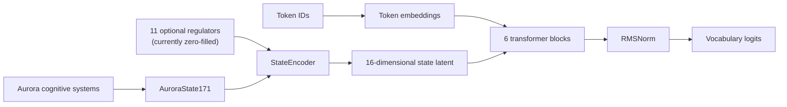

# AuroraLM

[](https://github.com/oanewman26-dot/LLM_Development/actions/workflows/ci.yml)
[](LICENSE)

## What it is

AuroraLM is an experimental decoder-only language model designed to receive
Aurora's live cognitive state as a real model input, rather than reducing that
state to descriptive prompt text.

The project asks a focused research question:

> Can a versioned 171-dimensional state signal improve model behaviour or
> expert-routing efficiency when compared with no state and shuffled-state
> controls?

Aurora's memory, appraisal, values, world model and action controls remain
outside the language model. AuroraLM is intended to be a replaceable voice
component within that wider system, not the whole mind.

> **Status:** research prototype. The public repository currently contains the
> runnable transformer core, state contract, tokenizer and untrained sparse-MoE
> implementations, with 65 automated model, data and training contract tests.
> It does not ship a trained model or claim production readiness. See
> [docs/STATUS.md](docs/STATUS.md) and
> [research boundaries](docs/EXPERIMENTAL_PLAN.md#research-boundaries).

## Architecture overview



The state encoder runs once per forward pass. Its compact latent is then
broadcast into the attention and feed-forward branches of every transformer
block through zero-initialised scale-and-shift conditioners.

This gives the project two important experimental properties:

1. At initialisation, random state and no state produce identical logits.
2. `CONTROL_PILOT` uses the same base architecture with state conditioning
   disabled, providing a clean comparison model.

The trained checkpoint and default `PILOT` path remain dense. Sparse MoE
mechanics are available only when `num_experts > 0`; the state prior has zero
routing influence until the state-material readiness gate is cleared.

The PILOT model has 9,994,960 parameters; the full settings table is in
[docs/PILOT_CONFIGURATION.md](docs/PILOT_CONFIGURATION.md).

### Why structured state instead of prompt text?

A prompt can describe an internal state, but the model may ignore it, imitate
its language without using the signal, or confuse the description with user
content.

AuroraLM instead defines the state as a versioned numerical contract,
`aurora-state-171-effective/v4`. Aurora produces the state and owns the
schema; AuroraLM consumes it:

- each of the 171 values is an effective value: the strongest present evidence
  for that emotion (fresh activation or established slow mood) multiplied by
  Aurora's learned weight for the node;
- the 171 emotion dimensions have a fixed order;
- missing nodes are represented explicitly as zero;
- invalid, negative and non-finite values are rejected;
- serialised records include a schema version and fingerprint;
- training and inference can reject incompatible state layouts;
- records of the superseded versions (`aurora-state-171/v1` raw activations,
  `aurora-state-171x2/v2`, `aurora-state-171-weighted/v3`) are rejected, not
  converted, because their values mean something different;
- one fixed calibration ceiling preserves the difference between quiet and
  intense states.

The 11 regulator values remain separate from the 171 emotion nodes so signals
such as tension, coherence, sleep pressure and confidence cannot be mistaken
for emotions.

The schema is published as a versioned artifact,
[docs/contracts/aurora-state-171-effective-v4.json](docs/contracts/aurora-state-171-effective-v4.json),
carried unchanged in both repositories. `tests/test_shared_state_contract.py`
checks this repository's definitions against it, and the Aurora repository
has a test of the same name.

`activation_calibration.py` validates every state record and publishes only
aggregate statistics and source digests; raw logs and conversation text
remain outside Git. Training and readiness checks reject, rather than clip, a
future score above the frozen ceiling.

The v4 ceiling is frozen at `0.6755945865328331`, the maximum positive
effective value in 19,649 genuine v4 captures (250,412 active values across
407 session logs), recorded in `calibration/activation_calibration_v3.json`.
The two earlier receipts, with a ceiling of `0.88`, were measured on
`aurora-state-171/v1` raw activations and are kept as records only. Datasets
and checkpoints built on v1 records are rejected on load and must be rebuilt
from v4 captures.

## Quick start

### 1. Clone and create an environment

```bash
git clone https://github.com/oanewman26-dot/LLM_Development.git
cd LLM_Development
python -m venv .venv
```

Activate it on Windows PowerShell:

```powershell
.\.venv\Scripts\Activate.ps1
```

Or on Linux/macOS:

```bash
source .venv/bin/activate
```

Install the development dependencies:

```bash
python -m pip install --upgrade pip
python -m pip install -r requirements.txt
python -m pip install -e . --no-deps
```

The source lives in `src/auroralm/`; the editable install makes the
`auroralm` package importable from anywhere in the environment.

### 2. Run a model forward pass

```python
import torch

from auroralm.config import PILOT
from auroralm.NN import AuroraLM

model = AuroraLM(PILOT)
tokens = torch.randint(0, PILOT.vocab_size, (2, 32))
aurora_state = torch.zeros(2, 171)

with torch.no_grad():
    logits = model(tokens, aurora_state)

print(logits.shape)  # torch.Size([2, 32, 8192])
```

This verifies the architecture only. Randomly initialised logits are not useful
language generation.

### 3. Use the tokenizer CLI

Train an 8,192-token byte-level BPE tokenizer from clean UTF-8 text:

```bash
python -m auroralm.tokenizer train \
  --input corpus.txt \
  --output artifacts/aurora_bpe_8192_v1 \
  --vocab-size 8192 \
  --min-frequency 2
```

Inspect a saved artefact:

```bash
python -m auroralm.tokenizer inspect artifacts/aurora_bpe_8192_v1
```

Encode a short string:

```bash
python -m auroralm.tokenizer encode artifacts/aurora_bpe_8192_v1 "Aurora notices the change."
```

Training corpora, private journals, checkpoints and generated artefacts should
be reviewed carefully and kept out of commits unless they are intentionally
licensed and suitable for publication.

To regenerate the privacy-safe activation receipt from private Aurora logs:

```bash
python -m auroralm.activation_calibration \
  --sessions-dir /path/to/aurora/session_logs \
  --output calibration/activation_calibration_v4.json
```

## Tests

```bash
python -m pytest -q
```

The suite runs on CPU, needs no network and no private data. One marker is
registered in `pyproject.toml`: `slow`, deselected with `-m "not slow"`.

The architecture and MoE suites can also be run without pytest:

```bash
python tests/test_smoke.py
python -m unittest discover -s tests -p "test_moe*.py" -q
python -m unittest discover -s tests -p "test_experts.py" -q
```

CI (`.github/workflows/ci.yml`) runs the full set of checks on Python 3.12,
and they can be run locally the same way:

```bash
python -m pip check
python -m ruff format --check .
python -m ruff check .
python -m mypy
python -m compileall -q .
python -m pytest -q
```

`python -m pre_commit install` registers the same checks as commit and push
hooks. Contribution rules are in [CONTRIBUTING.md](CONTRIBUTING.md); rules for
automated agents are in [AGENTS.md](AGENTS.md).

## Repo layout

| Path | Purpose |
| --- | --- |
| `src/auroralm/NN.py` | Top-level `AuroraLM` model |
| `src/auroralm/config.py` | Dense, MoE, compute-ladder and stateless control contracts |
| `src/auroralm/state_schema.py` | Canonical 171-dimensional state schema |
| `src/auroralm/state_encoder.py` | State compression and optional routing-prior head |
| `src/auroralm/activation_calibration.py` | Privacy-safe activation-ceiling calibration |
| `calibration/activation_calibration_v3.json` | Frozen aggregate calibration receipt for the v4 schema (v1 and v2 are kept, measured on the superseded v1 schema) |
| `docs/contracts/aurora-state-171-effective-v4.json` | Published state schema, identical in the Aurora repository |
| `src/auroralm/transformer_block.py` | Pre-norm residual block with state conditioning |
| `src/auroralm/moe_router.py` | Bounded-state token router and routing losses |
| `src/auroralm/experts.py` | Sparse SwiGLU dispatch, capacity handling and telemetry |
| `src/auroralm/rotary_position_embedding.py` | RoPE and grouped-query attention |
| `src/auroralm/RSMnorm.py` | RMSNorm implementation |
| `src/auroralm/feetforward.py` | SwiGLU feed-forward layer |
| `src/auroralm/tokenizer.py` | Byte-level BPE training, loading and encoding CLI |
| `src/auroralm/dataset.py` | Deterministic, privacy-conscious dataset preparation |
| `src/auroralm/smollm_sampler.py` | Deterministic sampler for bounded public-corpus slices |
| `src/auroralm/train.py` | Deterministic dense training for the PILOT stage |
| `src/auroralm/inference.py` | Strict checkpoint loading and autoregressive generation |
| `src/auroralm/readiness_gate.py` | Two-gate readiness audit before state-conditioned experiments |
| `artifacts/aurora_bpe_8192_v1/` | Versioned tokenizer artefact |
| `scripts/check_commit.py` | Commit-subject check used by CI and the commit hook |
| `tests/` | Test suite, including the repository-structure and commit-policy checks |
| `tests/test_smoke.py` | Ten model and architecture checks |
| `tests/test_tokenizer.py` | Nine tokenizer contract checks |
| `tests/test_moe_router.py` | Six router checks |
| `tests/test_experts.py` | Five sparse-dispatch checks |
| `tests/test_moe_integration.py` | Six end-to-end MoE compatibility checks |
| `docs/` | Status, PILOT configuration, experimental plan, roadmap and development notes; indexed in [docs/README.md](docs/README.md) |

## Roadmap and status

The current milestone and the dated verification record are in
[docs/STATUS.md](docs/STATUS.md). The experimental plan and the research
boundaries are in [docs/EXPERIMENTAL_PLAN.md](docs/EXPERIMENTAL_PLAN.md). The
longer technical plan is available in
[AuroraLM - State-Driven MoE Roadmap](./docs/AuroraLM%20-%20State-Driven%20MoE%20Roadmap.txt).

Near-term public milestones:

- publish deterministic dataset preparation after privacy review;
- publish dense training and inference contracts;
- freeze a representative tokenizer artefact;
- run controlled base-model training;
- gather genuine state-aligned turns;
- calibrate the state activation ceiling;
- run no-state, correct-state and shuffled-state ablations;
- train or evaluate MoE routing only after the readiness gates authorise it.

## License and contact

AuroraLM's original source code and documentation are copyright 2026 Omari
Newman and licensed under the [Apache License 2.0](LICENSE). See
[NOTICE](NOTICE) for attribution.

Third-party libraries, datasets and generated artefacts retain their own terms.
See [THIRD_PARTY_NOTICES.md](THIRD_PARTY_NOTICES.md) for the current dependency,
corpus and artefact scope. This repository does not release pretrained model
weights.

Citation metadata is available in [CITATION.cff](CITATION.cff).

Built by [Omari Newman](https://www.linkedin.com/in/omari-newman/).

- GitHub: [@oanewman26-dot](https://github.com/oanewman26-dot)
- LinkedIn: [linkedin.com/in/omari-newman](https://www.linkedin.com/in/omari-newman/)
